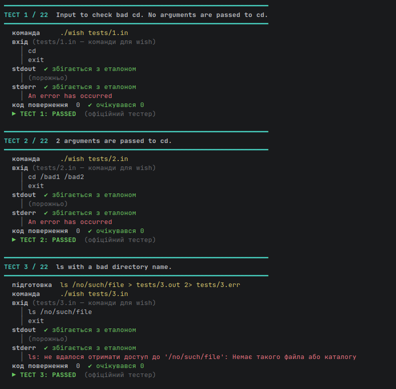
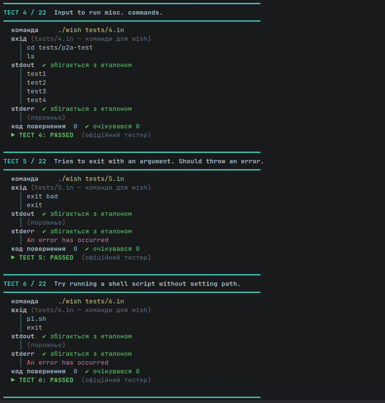
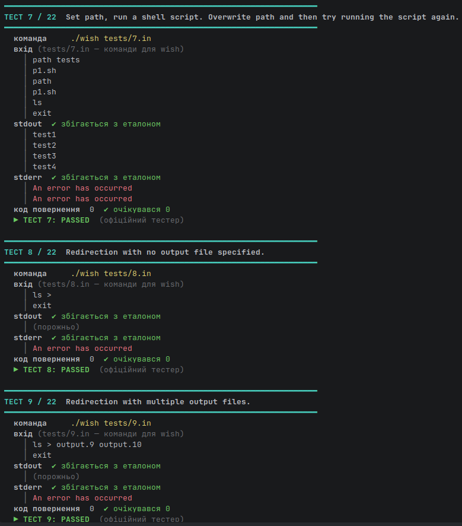
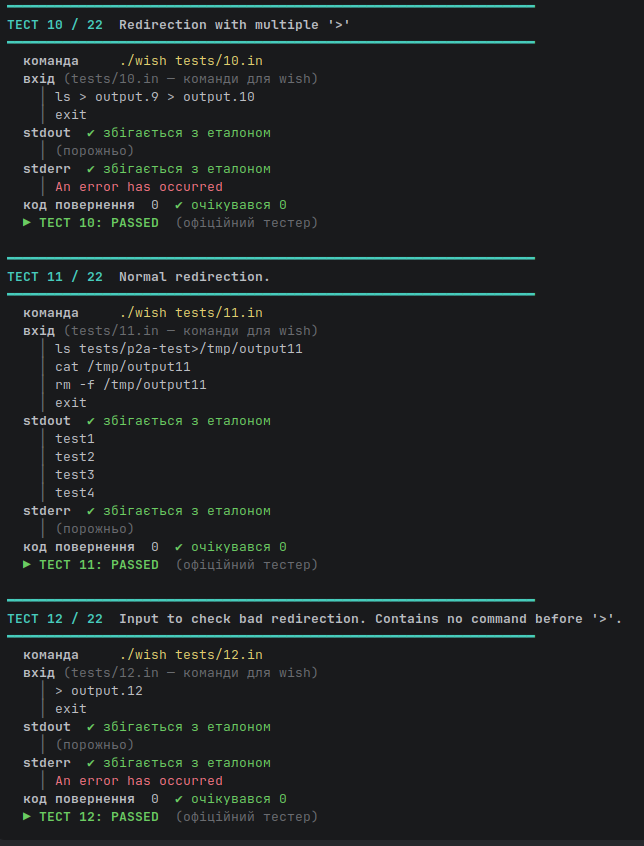
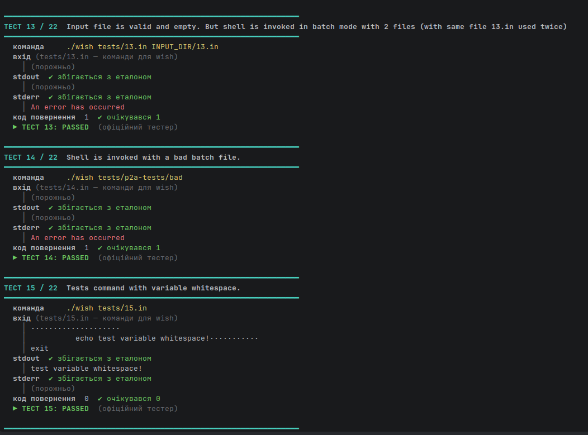
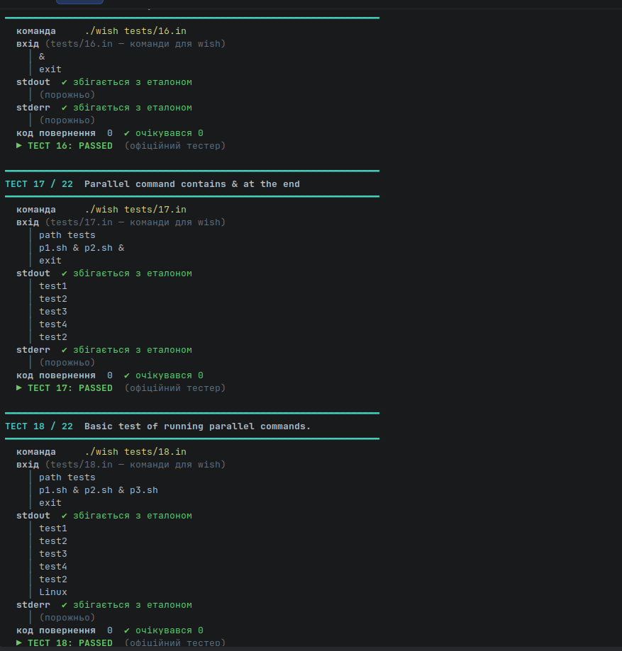
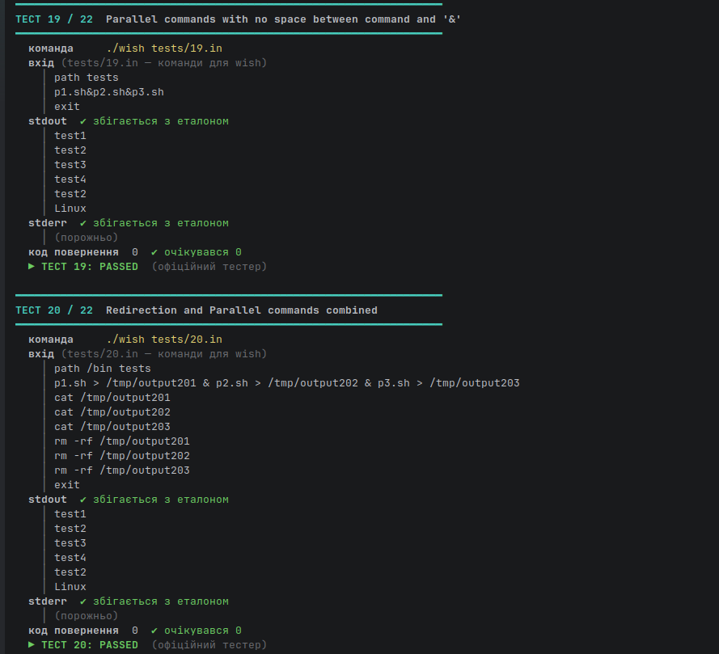
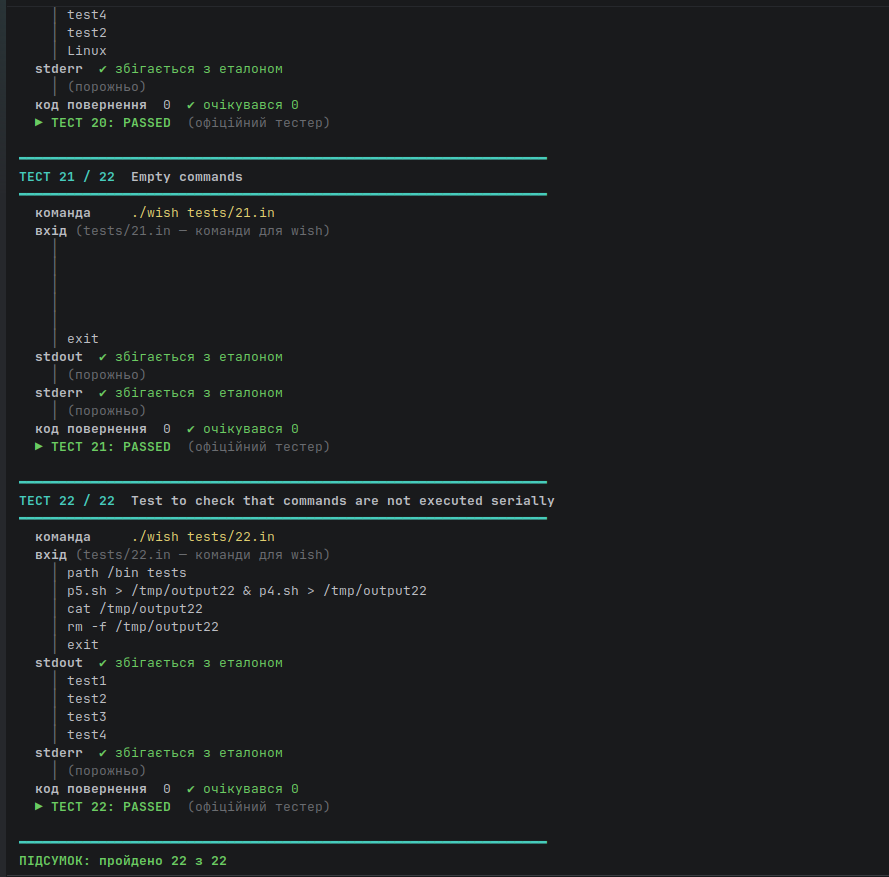

# wish — Wisconsin Shell (C++17)

Лабораторна робота №1 з операційних систем: власний командний інтерпретатор
(shell) мовою **C++17** за специфікацією
[OSTEP / processes-shell](https://github.com/remzi-arpacidusseau/ostep-projects/blob/master/processes-shell/README.md).

**Результат:** проходить усі **22 / 22 офіційні тести** курсу, збирається з
`-Wall -Wextra -Werror` без жодного попередження. Скріншоти проходження кожного
тесту — у розділі [4](#4-результати-запуску-тестів--скріншоти).

| Розділ | Про що |
|---|---|
| [1. Як усе працює](#1-як-усе-працює-і-що-робить-оболонка) | що вміє оболонка і що відбувається з кожним рядком команд |
| [2. Частини проєкту](#2-що-робить-кожна-частина-проєкту) | призначення кожного файлу та ключові рішення в коді |
| [3. Запуск і підготовка](#3-як-підготувати-й-запустити) | вимоги, збірка, CLion, запуск тестів |
| [4. Результати](#4-результати-запуску-тестів--скріншоти) | скріншоти: назва файлу = номери тестів |

---

## 1. Як усе працює і що робить оболонка

### 1.1 Що таке `wish`

`wish` — спрощений аналог `bash`. Він читає команди (з клавіатури або з файлу),
запускає відповідні програми як окремі процеси й чекає на їх завершення.
Мета лаби — на практиці розібратися, як ОС створює процеси й керує ними:
`fork()`, `execv()`, `waitpid()`, файлові дескриптори.

| Можливість | Приклад | Як реалізовано |
|---|---|---|
| Інтерактивний режим | `./wish` → запрошення `wish> ` | читання `std::cin` |
| Пакетний режим | `./wish script.txt` (без запрошення) | читання файлу |
| Запуск зовнішніх програм | `ls -la /tmp` | `fork()` + `execv()` + `waitpid()` |
| Вбудована `exit` | `exit` | завершує цикл читання |
| Вбудована `cd` | `cd /tmp` | `chdir()` у самій оболонці |
| Вбудована `path` | `path /bin /usr/bin` | замінює список каталогів пошуку |
| Перенаправлення виводу | `ls -la > out.txt`, `ls>out.txt` | `open()` + `dup2()` у дочірньому процесі |
| Паралельні команди | `cmd1 & cmd2 & cmd3` | спочатку всі `fork()`, потім усі `waitpid()` |

При будь-якій помилці оболонка друкує в stderr рівно одне повідомлення
`An error has occurred` і **продовжує роботу**. Єдиний виняток — неправильний
запуск самої оболонки (`./wish a b` або неіснуючий пакетний файл): тоді вихід із кодом `1`.

### 1.2 Шлях одного рядка

```
рядок тексту
   │  main.cpp: repl() — getline() з клавіатури або з файлу
   ▼
Shell::execute_line()                     executor.cpp
   │
   ├─► parse_line()                       parser.cpp
   │      ├─ tokenize()   "ls>out & date"  →  ls | > | out | & | date
   │      └─ поділ за '&' → vector<Command>{ argv, outfile, bad }
   │
   └─► для кожної команди:
          bad?            → report_error()                         error.cpp
          вбудована?      → Shell::run_builtin()  (exit / cd / path) builtins.cpp
          інакше          → SearchPath::resolve()  (пошук у path)   path.cpp
                            → fork() → [дитина: dup2() для '>' → execv()]
       ─── після циклу ───
          waitpid() на всі створені процеси
```

**Ключова ідея паралельності:** спочатку створюються **всі** дочірні процеси
рядка, і лише потім оболонка на них чекає. Якби `waitpid()` стояв усередині
циклу, команди з `&` виконувались би по черзі (тест 22 саме це ловить).
Наступний рядок починається лише тоді, коли завершились усі команди поточного.

### 1.3 Системні виклики

| Виклик | Навіщо |
|---|---|
| `fork()` | створити дочірній процес (копію оболонки) |
| `execv()` | замінити код дочірнього процесу потрібною програмою |
| `waitpid()` | дочекатися завершення конкретного процесу (без цього — зомбі) |
| `chdir()` | реалізація `cd` |
| `access(X_OK)` | перевірити, що файл існує й виконуваний |
| `open()` | відкрити / створити / обрізати файл перенаправлення |
| `dup2()` | підставити файл на місце дескрипторів 1 (stdout) і 2 (stderr) |
| `close()` | закрити зайвий дескриптор (у деструкторі `Fd`) |
| `write()` | вивести повідомлення про помилку без буферизації |
| `_exit()` | завершити дитину, не чіпаючи буфери батька |

Стандартна бібліотека C++ не має заміни жодному з них: `std::system()`
запускає окрему оболонку `/bin/sh` (що суперечить умові задачі),
а `std::filesystem` не вміє ні перевірити право на виконання так, як
`access(X_OK)`, ні перенаправити дескриптори.

---

## 2. Що робить кожна частина проєкту

### 2.1 Структура

```
OS_lab1_year4/
├── src/
│   ├── shell.hpp       типи Command / SearchPath / Shell, оголошення
│   ├── main.cpp        вибір режиму та цикл «прочитати — виконати»
│   ├── parser.cpp      рядок → лексеми → список команд
│   ├── builtins.cpp    Shell::run_builtin — exit / cd / path
│   ├── path.cpp        SearchPath::resolve — пошук виконуваного файлу
│   ├── executor.cpp    Shell::execute_line і Shell::spawn, RAII-клас Fd
│   └── error.cpp       єдине повідомлення про помилку
├── CMakeLists.txt      збірка для CLion + ціль run_tests
├── Makefile            збірка з терміналу (make / make test / make clean)
├── test-wish.sh        запуск офіційних тестів
├── show-tests.sh       наочний прогін тестів: вхід / очікувано / отримано
├── demo.sh             демонстрація кожної можливості окремим сценарієм
├── tests/              22 офіційні тести OSTEP (з репозиторію курсу, без змін)
├── tester/             офіційний скрипт-порівнювач (з репозиторію курсу, без змін)
└── docs/screenshots/   скріншоти проходження тестів (розділ 4)
```

### 2.2 `shell.hpp` — спільні типи

* `Command` — одна команда: `argv` (слова), `outfile` (`std::optional` — файл
  перенаправлення, якщо є) і прапорець `bad` (синтаксична помилка).
* `CommandLine` — усі команди одного рядка, розділені `&`.
* `SearchPath` — список каталогів пошуку програм, початково `{"/bin"}`.
* `Shell` — увесь змінний стан оболонки (шлях пошуку). Глобальних змінних немає.

### 2.3 `main.cpp` — режими роботи

```cpp
if (argc > 2)  { wish::report_error(); return 1; }   // ./wish a b — помилка
if (argc == 2) { std::ifstream batch(argv[1]); ... } // пакетний режим
```

* `argc == 1` → читаємо `std::cin`, перед кожним рядком друкуємо `wish> `
  (з явним `std::flush`, інакше запрошення застрягне в буфері).
* `argc == 2` → читаємо файл, запрошення **не** друкуємо. Файл не відкривається → код 1.
* `argc > 2` → помилка, код 1.

Рядки читаються через `std::getline` — довжина не обмежена. EOF (Ctrl-D або
кінець файлу) завершує роботу так само, як `exit`.

### 2.4 `parser.cpp` — розбір рядка

**Токенізатор** проходить рядок один раз:

* пробіли й табуляції — роздільники;
* `>` і `&` — окремі лексеми **незалежно від пробілів**, тому працюють і
  `ls > out`, і `ls>out`, і `p1.sh&p2.sh` (тести 11, 19);
* решта — звичайні слова.

`std::isspace` навмисно не використовується: вона залежить від локалі.

**Поділ на команди** — за `&`. Порожні ділянки (рядок `&`, хвостовий `&`)
пропускаються: за специфікацією це не помилка (тести 16, 17).

**Перенаправлення** перевіряється трьома умовами з умови задачі:

```cpp
if (redirects > 1 || arrow == begin || std::distance(arrow, end) != 2)
    cmd.bad = true;
```

| умова в коді | що означає | тест |
|---|---|---|
| `redirects > 1` | більше одного `>` — `ls > a > b` | 10 |
| `arrow == begin` | немає команди ліворуч — `> out` | 12 |
| `distance(arrow, end) != 2` | праворуч не рівно один файл — `ls >`, `ls > a b` | 8, 9 |

Помилка позначає лише цю команду — решта паралельних команд рядка виконається.

### 2.5 `builtins.cpp` — вбудовані команди

`cd` змінює робочий каталог **процесу**. Якби вона запускалась через `fork()`,
каталог змінився б у дочірньому процесі, який одразу завершується, а оболонка
лишилась би на місці. Так само `path` змінює стан оболонки, а `exit` має
завершити саму оболонку. Тому всі три виконуються без `fork()`.

```
exit  — рівно 0 аргументів, інакше помилка          (тест 5)
cd    — рівно 1 аргумент, інакше помилка; chdir()    (тести 1, 2, 4)
path  — будь-яка кількість аргументів                 (тести 6, 7)
```

Результат — `enum class Builtin { None, Done, Exit }`.

### 2.6 `path.cpp` — пошук програми

Змінна середовища `PATH` **не використовується**: у оболонки свій список,
початково `/bin`. `resolve("ls")` перебирає каталоги по черзі й перевіряє
`/bin/ls` через `access(X_OK)`. `path a b c` **повністю замінює** список;
`path` без аргументів робить його порожнім — тоді не запуститься жодна
зовнішня програма, лише вбудовані (тест 7).

### 2.7 `executor.cpp` — процеси та файлові дескриптори

```cpp
std::vector<char*> raw_argv;              // 1. argv готуємо ДО fork()
...
std::fflush(nullptr);                     // 2. скидаємо буфери stdio
const pid_t pid = ::fork();               // 3. копія процесу
if (pid == 0) {                           // 4. дитина
    redirect_output(*cmd.outfile);        //    open() + dup2(fd,1) + dup2(fd,2)
    ::execv(program.c_str(), raw_argv.data());
    report_error();
    ::_exit(1);                           //    сюди — лише якщо execv провалився
}
```

* **`argv` до `fork()`** — після `fork()` у дитині безпечні лише
  async-signal-safe функції, а виділення пам'яті такою не є.
* **`std::fflush(nullptr)`** — `fork()` копіює і невиведені буфери; без
  скидання той самий текст надрукувався б двічі.
* **`_exit()` замість `exit()`** — не запускає деструктори й не скидає
  успадковані буфери вдруге.
* **Перенаправлення** робиться в дитині після `fork()`, тож воно не впливає ні
  на оболонку, ні на сусідні паралельні команди. За умовою у файл ідуть і
  stdout, і stderr. Файл відкривається з `O_TRUNC` (обрізається).
* **RAII-клас `Fd`** закриває дескриптор у деструкторі; копіювання заборонене,
  переміщення дозволене. Забути `close()` неможливо.
* **Очікування** — після циклу `waitpid()` для кожного PID з вектора `children`.

### 2.8 `error.cpp` — повідомлення про помилку

```cpp
char error_message[30] = "An error has occurred\n";
::write(STDERR_FILENO, error_message, std::strlen(error_message));
```

Текст — байт у байт з умови. `write()` замість `std::cerr`, бо це системний
виклик без буферизації: повідомлення з'являється в правильному порядку відносно
виводу дочірніх процесів.

Помилки оболонки відрізняються від помилок самих програм: у тесті 3
`ls /no/such/file` запускається успішно, тому в stderr іде текст від `ls`,
а не `An error has occurred`.

### 2.9 Файли збірки й перевірки

| Файл | Що робить |
|---|---|
| `CMakeLists.txt` | збирає `wish` для CLion (C++17, `-Wall -Wextra -Werror`); кладе бінарник у **корінь проєкту**, бо тестер шукає саме `./wish`; додає ціль `run_tests` |
| `Makefile` | те саме з терміналу: `make`, `make test`, `make clean` |
| `test-wish.sh` | перевіряє, що `./wish` зібрано, і запускає офіційний `tester/run-tests.sh` |
| `show-tests.sh` | для кожного тесту показує опис, команду, вхід, stdout / stderr / код повернення з позначкою ✔ або ✘; вердикт бере з офіційного тестера |
| `demo.sh` | 11 сценаріїв, кожен демонструє одну можливість (вивід — у розділі 4) |
| `tests/N.*` | тест `N`: `.desc` опис, `.run` команда, `.in` вхід, `.out` / `.err` / `.rc` еталон |
| `tester/run-tests.sh` | запускає `N.run`, пише результат у `tests-out/`, порівнює через `diff` з еталоном |

### 2.10 Свідомі рішення

* **Жодних глобальних змінних** — стан живе в об'єкті `Shell`.
* **Пам'ять** — ні `new`/`delete`, ні `malloc`/`free`: усім володіють
  `std::string`, `std::vector`, `std::optional` і `Fd`. Перевірено
  `-fsanitize=address,undefined` — звітів немає.
* **`exit` серед паралельних команд** (`sleep 5 & exit`) — оболонка спершу
  дочікується вже запущених процесів, сиріт не лишається.
* **Вбудовані команди ігнорують перенаправлення** (`cd /tmp > out`) —
  специфікація цей випадок не описує.

### 2.11 Історія розроблення

`git log --oneline` показує покрокову розробку: каркас → повідомлення про
помилку → токенізатор → `exit`/`cd` → `path` → `fork`/`execv` →
перенаправлення → паралельність → пакетний режим → тести → порт на C++17
(`std::string`/`std::vector`/`std::optional`, потім клас `Shell` і RAII `Fd`)
→ документація й інструменти перевірки. Після кожного кроку всі тести проходять.

---

## 3. Як підготувати й запустити

### 3.1 Вимоги

| Що | Версія | Примітка |
|---|---|---|
| ОС | **Linux** (або WSL2 у Windows, або macOS) | потрібні `fork`, `execv`, `waitpid`; на «чистому» Windows (MinGW/MSVC) **не збереться** |
| Компілятор | `g++` ≥ 7 або `clang++` ≥ 5 (C++17) | перевірено на g++ 13.3.0 |
| CMake | ≥ 3.16 | у CLion вбудований (перевірено з CMake 4.3.1) |
| `make`, `bash`, `perl` | будь-які | збірка з терміналу, тести, `show-tests.sh` |
| CLion | будь-яка сучасна | необов'язково — усе працює і з терміналу |

Ubuntu/Debian, якщо чогось бракує:

```bash
sudo apt install g++ make cmake
```

### 3.2 Запуск із терміналу

```bash
git clone <посилання-на-репозиторій> OS_lab1_year4
cd OS_lab1_year4

make                     # зібрати ./wish
./test-wish.sh -c        # усі 22 тести коротко: test N: passed
./show-tests.sh          # усі тести докладно (як на скріншотах)
./show-tests.sh -p       # те саме з паузою (Enter) після кожного тесту
./show-tests.sh 7 22     # лише вибрані тести
./demo.sh                # демонстрація кожної можливості

./wish                   # інтерактивний режим
./wish tests/18.in       # пакетний режим
make clean               # прибрати артефакти збірки
```

Інші режими офіційного тестера: `./test-wish.sh` (зупинитись на першій
невдачі), `./test-wish.sh -v -t 22` (один тест з описом).

### 3.3 Відкрити в CLion

1. `File → Open…` → каталог `OS_lab1_year4` (де лежить `CMakeLists.txt`) → **Open as Project**.
2. *Trust Project?* → **Trust Project**; у *Open Project Wizard* профіль **Debug** → **OK**.
3. Унизу у вкладці **CMake** має бути `[Finished]`. Якщо ні — `File → Reload CMake Project`.

> CLion у Windows: `Settings → Build, Execution, Deployment → Toolchains` →
> додайте **WSL** і зробіть його першим. На MinGW/MSVC проєкт не збереться.

### 3.4 Перевірка в CLion

| Крок | Дія | Що має бути |
|---|---|---|
| Збірка | конфігурація **`wish`** → `Build 🔨` (`Ctrl+F9`) | `Build finished`, без попереджень |
| Тести | конфігурація **`run_tests`** → `Run ▶` (`Shift+F10`) | `test 1: passed` … `test 22: passed` |
| Докладно | термінал CLion (`Alt+F12`) → `./show-tests.sh` | ✔ у кожному тесті, `ПІДСУМОК: пройдено 22 з 22` |
| Вручну | конфігурація **`wish`** → `Run ▶` | запрошення `wish> `, команди виконуються |

Приклад ручної перевірки:

```
wish> ls
wish> cd /tmp
wish> pwd
wish> path /bin /usr/bin
wish> echo hello > out.txt
wish> cat out.txt
wish> sleep 2 & echo parallel
wish> exit
```

> Якщо ввід у вкладці *Run* поводиться дивно — увімкніть
> `Edit Configurations… → wish → Run in Terminal` (або `Emulate terminal in output console`).
>
> Якщо для `run_tests` CLion просить *Executable* — натисніть `Build 🔨` замість `Run ▶`.

**Пакетний режим із CLion:** `Run → Edit Configurations… → wish` →
*Program arguments:* `tests/18.in`, *Working directory:* `$ProjectFileDir$`
(робочий каталог має бути коренем проєкту — тести використовують відносні шляхи).

**Налагодження:** точки зупину на `Shell::execute_line()` і `Shell::spawn()`
у `src/executor.cpp`. Щоб пройти дочірній процес після `fork()`, увімкніть
`Settings → Build, Execution, Deployment → Debugger → Follow child process`.

### 3.5 Як влаштований тест

Тест `N` — це набір файлів у `tests/`:

| Файл | Вміст |
|---|---|
| `N.desc` | опис тесту |
| `N.run` | команда запуску, наприклад `./wish tests/7.in` |
| `N.in` | команди, які отримує оболонка |
| `N.out`, `N.err`, `N.rc` | очікувані stdout, stderr і код повернення |
| `N.pre` (не завжди) | підготовка перед тестом |

Тестер виконує `N.run`, зберігає результат у `tests-out/N.out`, `N.err`, `N.rc`
і порівнює з еталоном через `diff`. **Не збіглось хоча б одне з трьох — тест провалено.**

Перевірити тест вручну:

```bash
./wish tests/7.in > /tmp/my.out 2> /tmp/my.err; echo $? > /tmp/my.rc
diff /tmp/my.out tests/7.out && diff /tmp/my.err tests/7.err && diff /tmp/my.rc tests/7.rc && echo OK
```

---

## 4. Результати запуску тестів — скріншоти

Результати прогону знаходяться в каталозі
[`docs/screenshots/`](docs/screenshots/). **Назва кожного файлу відповідає
номерам тестів, які на ньому зображено:** `tests_1-3_img.png` — тести 1, 2 і 3,
`tests_19-20_img.png` — тести 19 і 20 тощо.

Знято командою `./show-tests.sh`. На кожному скріншоті для кожного тесту видно:
команду запуску, вхідний файл, stdout і stderr з позначкою
**✔ збігається з еталоном**, код повернення та вердикт офіційного тестера
**PASSED**. Табуляції показано як `⇥`, пробіли в кінці рядка — як `·`.

| Файл | Тести | Що перевіряють |
|---|---|---|
| [`tests_1-3_img.png`](docs/screenshots/tests_1-3_img.png) | 1, 2, 3 | `cd` без аргументу; `cd` з двома аргументами; помилку друкує сам `ls`, а не оболонка |
| [`tests_4-6_img.png`](docs/screenshots/tests_4-6_img.png) | 4, 5, 6 | `cd` + `ls` і вихід по EOF; `exit` з аргументом; програми немає в `/bin` |
| [`tests_7-9_img.png`](docs/screenshots/tests_7-9_img.png) | 7, 8, 9 | `path` замінює / очищає шлях; `ls >` без файлу; `ls > a b` — два файли |
| [`tests_10-12_img.png`](docs/screenshots/tests_10-12_img.png) | 10, 11, 12 | два `>`; `>` без пробілів; немає команди перед `>` |
| [`tests_13-15_img.png`](docs/screenshots/tests_13-15_img.png) | 13, 14, 15 | два аргументи оболонці → код 1; неіснуючий пакетний файл → код 1; зайві пробіли |
| [`tests_16-18_img.png`](docs/screenshots/tests_16-18_img.png) | 16, 17, 18 | рядок з одного `&`; `&` у кінці; базова паралельність |
| [`tests_19-20_img.png`](docs/screenshots/tests_19-20_img.png) | 19, 20 | `&` без пробілів; перенаправлення разом із паралельністю |
| [`tests_21-22_img.png`](docs/screenshots/tests_21-22_img.png) | 21, 22 + підсумок | порожні рядки; команди справді паралельні; **ПІДСУМОК: пройдено 22 з 22** |

### Тести 1–3



### Тести 4–6



### Тести 7–9



### Тести 10–12



### Тести 13–15



### Тести 16–18



### Тести 19–20



### Тести 21–22 і підсумок



### Як тест 22 перевіряє справжню паралельність

`p5.sh` спить 4 секунди й пише `test1…test4`, `p4.sh` одразу пише `Linux` —
обидва в **один** файл, і кожен відкриває його з `O_TRUNC`.

* **Паралельно:** обидва відкривають файл майже одночасно; `Linux` записується
  першим, а через 4 с довший вивід `p5.sh` його перекриває → у файлі
  `test1…test4` → тест пройдено (видно на скріншоті).
* **Послідовно:** `p4.sh` відкрив би файл після завершення `p5.sh`, обрізав би
  його й лишив тільки `Linux` → тест провалено.

### Додатково: вивід `./demo.sh`

<details>
<summary>Демонстрація кожної можливості окремим сценарієм (натисніть, щоб розгорнути)</summary>

```
$ ./demo.sh
=== 1. Зовнішні програми (fork + execv + waitpid)
--- скрипт:
    echo hello from wish
    uname -s
--- вивід:
    hello from wish
    Linux
--- код повернення: 0

=== 2. Вбудована cd
--- скрипт:
    cd /usr
    pwd
    cd /tmp
    pwd
--- вивід:
    /usr
    /tmp
--- код повернення: 0

=== 3. Помилка програми — це її власний stderr, а не помилка оболонки
--- скрипт:
    ls /nonexistent
--- вивід:
    ls: cannot access '/nonexistent': No such file or directory
--- код повернення: 0

=== 4. Помилка cd: немає аргументу / забагато аргументів
--- скрипт:
    cd
    cd /a /b
    echo shell continues
--- вивід:
    An error has occurred
    An error has occurred
    shell continues
--- код повернення: 0

=== 5. Вбудована path: програма шукається лише в заданих каталогах
--- скрипт:
    path /nonexistent
    whoami
    path /tmp /usr/bin
    whoami
    path
    echo path is empty now, so this fails
--- вивід:
    An error has occurred
    mykola
    An error has occurred
--- код повернення: 0

=== 6. Перенаправлення виводу (stdout і stderr у файл)
--- скрипт:
    echo written to file > out.txt
    ls /nonexistent>err.txt
    cat out.txt
    cat err.txt
--- вивід:
    written to file
    ls: cannot access '/nonexistent': No such file or directory
--- код повернення: 0

=== 7. Некоректне перенаправлення
--- скрипт:
    ls >
    ls > a b
    ls > a > b
    > a
--- вивід:
    An error has occurred
    An error has occurred
    An error has occurred
    An error has occurred
--- код повернення: 0

=== 8. Паралельні команди через & (три sleep 2 — разом 2 с, а не 6)
--- скрипт:
    date +%T
    sleep 2 & sleep 2 & sleep 2
    date +%T
    echo A & echo B & echo C
--- вивід:
    09:37:10
    09:37:12
    A
    B
    C
--- код повернення: 0

=== 9. Довільні пробіли, табуляції та порожні рядки
--- скрипт:
         echo    spaced     out
    
    	
    &
    echo still alive
--- вивід:
    spaced out
    still alive
--- код повернення: 0

=== 10. exit з аргументом — помилка; без аргументу — вихід
--- скрипт:
    exit 1
    echo not exited yet
    exit
    echo never printed
--- вивід:
    An error has occurred
    not exited yet
--- код повернення: 0

=== 11. Неправильний виклик оболонки
--- ./wish a b
    An error has occurred
--- код повернення: 1
--- ./wish no-such-file
    An error has occurred
--- код повернення: 1
```

</details>
